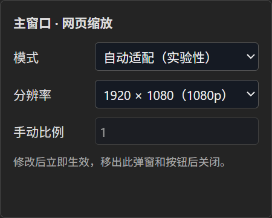

# MultiView Browser

基于 Electron / Chromium 的 Windows 多网页分屏浏览器，用于在一个桌面窗口中并排查看和操作多个网页。

## 项目定位

适合多网页对照、直播与信息看板并行查看，以及需要频繁切换主次网页的桌面使用场景。当前处于持续开发阶段，功能版本为 **V0.1.1.5**，尚有待修复的状态同步和网站兼容性问题。

正式项目名称、窗口标题及产品元数据统一为 MultiView Browser；可执行文件名为 `MultiViewBrowser.exe`。

## 核心功能

- **分屏布局**：16种内置布局，可拖动分割线、保存自定义布局；网页关闭后留空，不自动补位。
- **窗口换位**：拖动“主、2、3”等按钮交换网页，保持网页实例；拖动期间网页继续播放与渲染。
- **独立音频控制**：总音量0–150%，页面音量0/25/50/75/100%；支持静音和主窗口放大期间的临时静音策略。网站联动和增益有兼容性限制。
- **网页缩放**：悬停浮窗选择1080p、1440p或4K；主窗口放大期间临时使用2K。自动适配固定逻辑视口为实验性功能，另有原生响应式兼容模式。
- **收藏与工作区**：收藏单页编辑、分组与收藏拖动排序、可开关的横向收藏栏；保存和恢复布局及网页组合，支持JSON配置导入导出。
- **会话操作日志**：每次启动独立记录操作类别，不记录具体网址、标题、输入文字或凭据。

操作细节见[使用指南](docs/USER_GUIDE.md)。上述为已实现能力，不表示所有网站和时序场景均已验收；待处理事项见[已知问题](docs/KNOWN_ISSUES.md)，不作为已实现功能宣传。

## 界面截图

以下为实际运行时的缩放设置浮窗截图，仅展示局部界面，不是完整主窗口截图。



## 安装与使用

当前仓库保存源码，构建产物不纳入Git。本文不假定已有可下载的GitHub Release或安装器。

如果已取得Windows免安装构建，保留整个 `win-unpacked` 目录，运行 `MultiViewBrowser.exe`。本地项目已有构建时，也可双击根目录的 [Start-MultiViewBrowser.cmd](Start-MultiViewBrowser.cmd)，它指向 `release/win-unpacked/MultiViewBrowser.exe`；仅克隆源码还不能直接使用该脚本。机器专用快捷方式不随仓库分发。

程序默认最大化；F11切换全屏，Esc退出全屏。首次使用及音频、缩放操作见[使用指南](docs/USER_GUIDE.md)。当前免安装构建未签名。

## 开发环境与快速启动

建议在Windows x64和Node.js 24环境开发，使用npm及仓库锁文件安装依赖。

```powershell
npm ci
npm run dev
```

生产构建、本地启动与免安装打包：

```powershell
npm run build
npm start
npm run pack
```

`npm start` 需要先构建。`npm run pack` 生成Windows目录构建；`npm run dist` 配置为NSIS安装器，不能把“已配置”视为“已交付”。完整命令及本机特殊环境处理见[开发指南](docs/DEVELOPMENT.md)。

## 技术栈

Electron / Chromium WebContentsView、React、TypeScript、Vite、esbuild、Zod、Vitest、electron-builder。实际依赖版本以 [package-lock.json](package-lock.json) 为准；模块关系见[架构说明](docs/ARCHITECTURE.md)。

## 当前状态与限制

自动固定视口缩放仍属实验性；跨域iframe、DRM及网站自有音频图不能保证统一音量控制。已审计出的配置旧写覆盖、播放器来源交接、音量同步解除静音等问题仍未解决。真实直播间验证曾被验证码阻断，长期播放、多屏DPI和完整系统鼠标路径尚需人工回归。

31项测试通过不代表不存在上述缺陷。V0.1.1.5已验证交换后的真实网页焦点和状态保留，并更新Windows免安装构建。详见[验证记录](docs/VALIDATION.md)。

## 文档导航

| 文档                                            | 用途                       |
| ----------------------------------------------- | -------------------------- |
| [CHANGELOG](CHANGELOG.md)                       | 有证据支持的版本变化       |
| [使用指南](docs/USER_GUIDE.md)                  | 面向使用者的实际操作       |
| [开发指南](docs/DEVELOPMENT.md)                 | 安装依赖、开发、测试和打包 |
| [架构说明](docs/ARCHITECTURE.md)                | 进程、模块、数据与安全边界 |
| [已知问题](docs/KNOWN_ISSUES.md)                | 未解决问题、复现条件和状态 |
| [开发日志](docs/DEVLOG.md)                      | 技术演进、原因分析及取舍   |
| [验证记录](docs/VALIDATION.md)                  | 测试方法、已有结果与局限   |
| [历史报告与分类映射](docs/DOCUMENTATION_MAP.md) | 原文去向与维护方式         |
| [AGENTS.md](AGENTS.md)                          | 版本、隐私及长期文档约束   |

## License / 版权状态

当前仓库未提供LICENSE文件，尚未声明项目的开源许可证；不能据此声称采用MIT等许可证。第三方依赖的许可与版权归其各自权利人，项目代码的使用、修改和分发授权请向作者确认。
