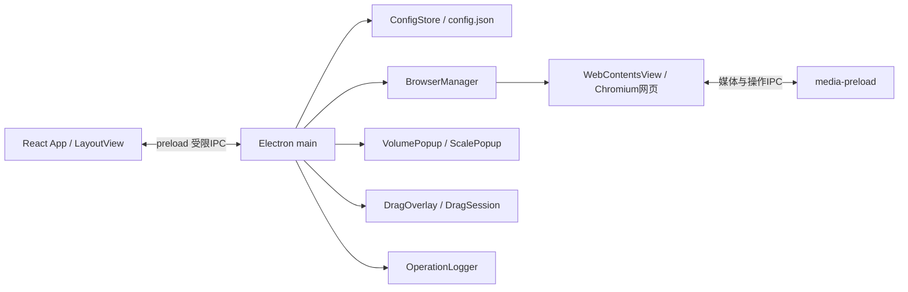

# 架构说明

当前代码基线V0.1.1.4。本文描述已经实现的结构，不把改进建议写成现状。

## 进程与模块

| 层         | 代码入口                                                                               | 责任                                                                  |
| ---------- | -------------------------------------------------------------------------------------- | --------------------------------------------------------------------- |
| 主进程     | [main.ts](../electron/main.ts)                                                         | 生命周期、最大化、IPC来源及Zod参数校验、配置保存、原生浮窗和会话广播  |
| React界面  | [App.tsx](../src/App.tsx)、[LayoutView](../src/components/LayoutView.tsx)              | 工具栏、收藏/工作区、选择状态、页面边界上报与配置编辑                 |
| 网页管理   | [BrowserManager](../electron/BrowserManager.ts)                                        | 按稳定page ID维护原生实例，导航、焦点事件、媒体设置、可见性与设备模拟 |
| 布局       | [LayoutManager](../src/core/LayoutManager.ts)、[ViewBounds](../src/core/ViewBounds.ts) | 树形分割、槽位计算、相邻比例调整、网页区域预留边界                    |
| 模型及存储 | [model](../src/core/model.ts)、[storage](../electron/storage.ts)                       | Zod schema、HTTP/HTTPS URL限制、配置验证、临时文件替换与有效备份      |

## 布局与拖拽

布局为叶子槽位或带轴向、比例和子树的split节点。16种内置布局定义在LayoutManager；配置允许空槽，换位保持网页ID与原生实例。AudioManager.swapPages同时实现主窗口进入/移出音频规则。

[DragOverlay](../electron/DragOverlay.ts)为透明原生窗口，位于网页上方，统一接收应用窗口拖动；[DragSession](../src/core/DragSession.ts)验证源与有效期。拖动期间底层继续渲染，站点视频/聊天元素不接收交互。收藏拖动仍走另一条React路径，限制见KI-05。

## 缩放与原生浮窗

[ScaleManager](../src/core/ScaleManager.ts)计算逻辑视口与实际矩形的缩放和居中。auto为contain等比适配；manual使用指定比例并裁剪；responsive禁用设备模拟。默认逻辑视口1920×1080。App在主窗口内部放大时通过displayScale临时覆盖为auto、2560×1440，原配置不改写。

BrowserManager.bounds设置WebContentsView边界及Chromium设备模拟。[ScalePopup](../electron/ScalePopup.ts)和[VolumePopup](../electron/VolumePopup.ts)使用独立受限preload及本地HTML，懒创建、异步加载并用代次标记取消过期显示请求；不会为弹窗改变网页尺寸。

## 音频

[AudioManager](../src/core/AudioManager.ts)计算原生静音策略；BrowserManager将全局静音、页面策略和放大临时静音合并。页面百分比与总百分比分别保存。

[media-preload](../electron/media-preload.ts)以HTML媒体volume作为页面绝对音量，安全可接入时使用独立Web Audio Gain处理总音量。可接入媒体的有效输出按两者乘积计算；这不是跨站点保证。通过[media-documents](../electron/media-documents.ts)发现同源iframe文档，跨域保持隔离。来源交接与站点同步仍有KI-02/03，不应概括为完全双向同步。

## IPC与安全边界

[preload](../electron/preload.ts)通过contextBridge暴露有限接口，[api.ts](../src/api.ts)声明界面类型。远程网页关闭Node集成、启用contextIsolation与sandbox；主进程检查sender和mainFrame，IPC参数按通道校验。共享persist:multiview会话；摄像头、麦克风、通知等权限请求默认拒绝。

主界面配置保存、原生浮窗编辑及网页volumechange是不同IPC入口；当前仍会各自读写完整配置，不是单一状态所有者。这是KI-01的根源，不应在架构图中宣称已实现修订号或补丁式存储。

## 持久化、日志和构建

ConfigStore在Electron userData保存config.json，schema版本为1；临时文件写入后替换，旧有效文件备份为.bak，主文件无效时尝试备份。工作区保存Snapshot（布局、页面URL/音频/缩放），不保存登录Cookie的独立副本。

[OperationLogger](../electron/OperationLogger.ts)、[OperationLog白名单](../src/core/OperationLog.ts)与[界面采集](../src/operation-log.ts)记录操作类别及受控元数据；具体网址、标题、输入、凭据和原始错误不进操作日志。audio-status/audio-probe是专项诊断通道，不是操作日志内容。

Vite构建React，esbuild构建主进程和preload并复制浮窗HTML，electron-builder按package.json文件清单打包。过程见[开发指南](DEVELOPMENT.md)，已知风险见[问题清单](KNOWN_ISSUES.md)。

### 5E自动适配兼容路径

BrowserManager在子文档加载完成后识别直播页面中oss.5eplay.com/nesting_file/嵌入页。对25%–500%的auto模式保持原fit矩形，禁用设备图像模拟并使用isolated原生zoom；同域其他页面不联动。切回响应式/手动、离开该站点或低于25%时复原zoom=1并使用原路径。没有向跨域iframe注入Node或伪造按钮点击，也不修改网站DOM。

### 独立Page Zoom

Page.pageZoom默认1，存入Snapshot及工作区。BrowserManager按稳定页面ID维护比例，原生zoom-changed处理Ctrl滚轮，before-input-event处理Ctrl快捷键；所有WebContents设置isolated缩放模式防止同域联动。PageZoom.ts仅定义浏览器常用档位和边界，实际缩放由WebContents.setZoomFactor完成，不注入CSS Transform。外层界面快捷键经可信IPC转发到选中网页。

普通路径保留原设备模拟参数，并叠加内容Page Zoom。5E兼容路径的实际原生因子为fit.factor×pageZoom；超出25%–500%时回退原设备模拟，保留既有兼容限制。所有路径均不因内容比例调整原bounds。

缩放反馈由electron/ZoomFeedback.ts管理：BrowserManager在用户缩放后读取getZoomFactor并触发独立提示，后续bounds更新跟随网页实例位置。提示使用不获取焦点且原生鼠标穿透的透明子窗口，避免被WebContentsView遮挡；无额外页面脚本、持久化字段或IPC权限。计时与淡出仅控制提示，不写入缩放状态。

## 设置与会话持久化（V0.2.1.0）

preferences独立于工作区Snapshot和Page局部状态；旧配置经schema迁移保持原默认体验。SettingsService负责可信IPC、外观、清理、诊断和固定外部链接；BrowserManager读取权限/重试策略，preload将UI缩放坐标换算为原生DIP。ConfigStore区分运行内存会话和磁盘保存快照，关闭自动保存时继续存其他配置。关闭握手将最新界面快照交给主进程后再确认关闭并记录windowState；超时回退最后确认状态。见[设置分层](SETTINGS.md)。
