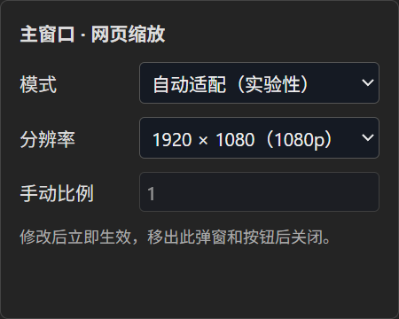

# 使用指南

适用V0.2.1.10。下文使用正式名称MultiView Browser，界面及窗口标题已统一为MultiView Browser。首次运行需已有构建，见[开发与打包](DEVELOPMENT.md)。

## 启动、分屏与导航

运行完整免安装目录里的MultiViewBrowser.exe；项目内已有release/win-unpacked时也可运行根目录启动脚本。默认最大化，F11切换全屏，Esc退出全屏。

点击“布局”选择16种内置布局，拖动分割线调整比例，可保存为自定义布局。窗口称为主窗口、2号窗口等，拖动按钮简称为“主、2、3”。关闭网页后保留空位，不自动补齐；空位仍可添加网页。

点击空位的添加按钮打开网页，默认网址可在“设置→网页浏览”修改，初始为Bilibili直播首页；可再用地址栏输入HTTP/HTTPS网址。网页工具栏提供前进、后退、刷新及关闭。

普通左键链接在当前网页打开；Bilibili直播间的个人主页链接作为例外填入空槽，槽满进入暂存区，原直播页面保持不变。中键按窗口编号顺序填入第一个空槽，无空槽则进入暂存区。非中键触发的脚本弹窗也按当前页导航处理。网站脚本及iframe的特殊导航应结合实际网站验证，不能视为所有浏览器扩展行为都受支持。

## 换位与内部放大

按住“主、2、3”等拖动按钮，拖到其他窗口的标题栏、网页区域或空位放下以交换。拖动期间底层网页继续播放与渲染，站点元素不可交互，空位显示“拖拽至此处交换”；结束后恢复交互。

双击主窗口网页外围留白，或点击“放大主窗口”，可隐藏其他网页，再次操作恢复分屏。主窗口内部放大期间临时使用2K（2560×1440）自动适配，恢复后还原原分辨率及缩放模式；这与程序最大化和F11全屏不同。

双击其他窗口外围留白会与主窗口交换；若该副窗口为空，则把主窗口网页移入该空位，焦点跟随网页留在该副窗口。网页内容内的双击不被应用接管，响应式模式下可能没有外围留白。

## 音频

总音量默认100%，支持0–150%；25%、50%、75%、100%附近吸附，选中滑块后方向键按5%调整。点击总扬声器静音，再点恢复保留值；拖动总音量会解除总静音。

悬停页面扬声器显示等宽纵向滑块，可选0/25/50/75/100%。点击扬声器切换静音，音量和静音状态分别处理。总音量与页面音量独立保存；例如可安全接入的页面50%×总音量80%为40%输出。

网页进入主窗口时清除先前静音策略，页面音量为0会恢复100%；移出主窗口恢复自动静音策略，保留百分比；无关页面手动设置不变。放大时非主窗口临时强制静音，主窗口保持原状态，总静音始终优先。

页面内置音量联动是针对支持HTML媒体事件的实现目标；目前仍存在播放器替换、网页程序化音量解除静音等[已知问题](KNOWN_ISSUES.md)。150%不保证对跨域、DRM或自有音频图生效。

## 缩放

网页内容缩放（Page Zoom）：鼠标放在目标网页上，按住Ctrl滚动滚轮；即使另一网页有键盘焦点，也只改变鼠标所在视图。Ctrl++或Ctrl+=放大、Ctrl+-缩小、Ctrl+0恢复100%。键盘操作针对当前网页，地址栏/外层界面获焦时针对当前选中网页。支持25%、33%、50%、67%、75%、80%、90%、100%、110%、125%、150%、175%、200%、250%、300%、400%、500%。

操作时，目标网页右上角短暂显示内核实际生效的缩放百分比；停止约2秒后淡出，提示不获取焦点且鼠标可穿透，恢复100%也会显示。提示随网页实例移动，不随网页滚动。含5E组件的自动适配会将适配与内容缩放合并到原生内核比例，因此提示可能不同于保存的内容缩放档位；Ctrl+0仍只复位内容缩放。

该功能使用内核原生页面缩放，不改变分屏容器；比例随网页实例和配置保存，交换后保留。Ctrl+0只复位内容缩放，不重置下面的逻辑分辨率、适配模式及分割线。

悬停齿轮缩放按钮打开小浮窗，鼠标可移入浮窗修改，离开按钮与浮窗后自动隐藏。支持1920×1080、2560×1440、3840×2160，新网页默认1080p，旧自定义尺寸在选择预设前保留。

模式包括自动适配（实验性）、原生响应式（兼容）和手动比例（裁剪）。只有手动模式可修改比例。主窗口放大期间显示锁定2K，恢复分屏后可继续编辑原设置。

## 收藏与收藏栏

点击“收藏夹”，用“＋”或“收藏当前网页”打开单页表单，一次填写名称、网址、分组和备注并保存。可搜索名称、地址、分组或备注；可编辑、删除收藏及管理分组。拖动分组或收藏调整顺序，收藏可跨组移动。

点击顶部“收藏栏”或设置中的开关显示横向收藏栏，不显示分组名，组间以竖线分隔，按分组及收藏顺序排列。

收藏夹提供“打开位置”下拉框。由于网页焦点与外层选中状态有KI-04，建议在打开收藏前显式确认目标；收藏拖入已加载网页内容区域存在KI-05，不要把该路径当作可靠支持。

## 布局、工作区及导入导出

自定义布局保存分屏结构和比例；工作区保存网页组合、布局、页面音频和缩放，支持保存、应用、重命名、覆盖和删除。应用工作区会重新打开相应网页，不是保留实时网页状态的快照。默认尝试恢复上次会话，可在设置中关闭恢复。

设置中可导出JSON完整配置，也可导入；导入会替换当前配置。配置包含实际网址、收藏名称和备注，应自行保管，勿与经过隐私过滤的操作日志混淆。导入一致性和最终保存风险见KI-06/08。

## 数据和排查

配置及浏览器站点数据位于Electron userData，Windows通常为%APPDATA%/multiview-browser；网页登录信息由共享Chromium会话管理，不包含在工作区或JSON配置的Cookie副本中。

操作日志每次启动一个文件，项目内默认写入logs；移出项目的免安装目录通常写在exe同级logs，不可写时回退userData/logs。文件名含版本、北京时间、进程号及唯一后缀，每行JSON包含事件序号、UTC时间和启动后毫秒数；slot:0为主窗口、slot:1为2号窗口。

日志不记录具体网址、标题、输入文字、按键字符、收藏名称、密码、Cookie、文件路径或原始错误，连续输入和滚动会节流。正常退出有session.end，强制终止或断电可能无结束记录，日志不自动清理。反馈问题时可提供版本、步骤和对应日志；不要上传浏览器用户目录或完整私人配置。

## 页面暂存区

开启收藏栏后，右侧“页面暂存”的左边缘与顶部“放大主窗口”按钮对齐。悬停按钮显示同宽列表，移出按钮和列表后关闭。有空位时单击条目（或选中后Enter）按编号填入第一个空位；槽满时保留。列表优先显示页面标题，未获取或无标题时显示网址，暂存随配置保存，关闭收藏栏不清空。

将任意网页的拖动按钮拖到暂存入口即可收起该网页并留下空位；将列表条目拖到空窗口则移入，拖到非空窗口则交换，原网页进入暂存。拖入暂存的网页在本次运行期间保留实例和状态，并强制静音；拖回后按主副窗口声音规则处理。重启后从保存的地址和页面设置恢复，网页DOM运行状态不跨进程保存。槽满新开链接仍仅保存地址和名称。标题串行读取，超时12秒保留网址，最多5000条。

顶部“＋ 网页”在槽满时同样把默认直播首页加入暂存区；收藏栏隐藏时可先通过顶部“收藏栏”按钮显示暂存入口。

暂存列表可拖到其他条目位置调整上下顺序，顺序随配置保存；仍可直接拖至窗口移入或交换。每项右侧的×关闭该条暂存网页（若保留网页实例则一并释放），不会打开网页或改变其他条目。

## 设置

顶部“设置”提供常规、网页浏览、收藏栏、外观、数据与隐私、关于与诊断六类。默认值保持旧体验。新页面默认分辨率、模式和Page Zoom只影响之后创建的页面；工作区快照与已有页面不回写。自动保存会话可关闭，不影响收藏、偏好、暂存和手动命名工作区保存。设置中的文字提示开关不会关闭音量/缩放/暂存的悬停面板。导入可选择覆盖范围，删除日志、有限保留策略和缓存清理均要求确认；清缓存不删除Cookie或站点存储。详细覆盖关系、权限和限制见[设置说明](SETTINGS.md)。

V0.2.1.1起，顶部不再提供收藏夹、收藏栏开关及新增网页按钮。收藏编辑、分组、搜索和添加当前网页位于“设置→收藏栏”；收藏栏显示位于“设置→收藏栏”。通过空窗口的“添加网页”打开新页面，其默认网址可在“设置→网页浏览”设定，仅支持HTTP/HTTPS，未修改时仍为Bilibili直播首页。收藏、普通链接及中键目标不受此默认值影响。布尔选项使用可点击或键盘操作的开关按钮。

设置采用应用内全窗口视图，左侧分类固定，右侧内容独立滚动；切换分类回到顶部，使用左上角返回或Esc回到浏览器。

V0.2.1.3：设置是应用内全窗口页面，左上角“返回浏览器”或Esc返回；原网页在后台保留。收藏管理已合并到“收藏栏”，保留＋添加和列表编辑；搜索、打开位置、独立新建分组及底部收藏当前网页已移除。添加/编辑收藏时，下拉框显示已有分组，也可点击表单内“新建分组”，填写名称后与收藏一并保存。

应用主题在“设置→外观”选择深蓝（Dark Navy，默认）、深灰（Dark Gray）、纯黑（Just Black）或浅色（Light）。主题只改变应用界面的背景、文字、边框和表面颜色，不改变布局与操作方式；空槽、菜单和操作浮窗同步切换。

设置页左侧分类按钮可切换设置类别；左上角箭头按钮或Esc返回浏览器，原网页继续运行。开关的圆点靠右表示开启、靠左表示关闭。

页面暂存和网页缩放浮窗支持在应用内悬停或点击对应按钮打开。切换到其他应用时关闭，返回浏览器不会自动重开；任务栏预览不作为打开操作。点击浮窗内部控件仍可正常修改设置。

强调色独立于主题，在同一页面选择“默认蓝色”（沿用页面音量按钮的亮蓝色 `#29B6FF`）、“青绿色”（`#148C83`）或“紫色”（`#8070C7`）。选择会用于导航选中、主要按钮、开关、滑块和焦点等状态；浅色背景上的强调色区域会自动使用易读的前景文字。切换主题不会改变强调色，切换强调色也不会改变主题，两者即时生效、分别保存，重启后恢复。旧配置的强调色会保留，未设置时使用默认蓝色；仍保存为浅色的旧配置可恢复浅色，已经被旧版本迁移成深蓝的配置需自行重新选择。

三种暗色主题向Chromium声明暗色偏好，浅色主题声明浅色偏好；默认网页根滚动条采用对应原生外观，无需刷新。网页可以保留自身背景，网站若主动响应深浅色偏好，可自行改变样式；应用不启用强制网页暗色模式，也不注入覆盖网站滚动条的CSS。网站通过CSS明确指定的原生配色方案、自定义滚动条和iframe配色仍予保留。原生窗口及系统界面的最终外观也受Windows支持情况影响。
